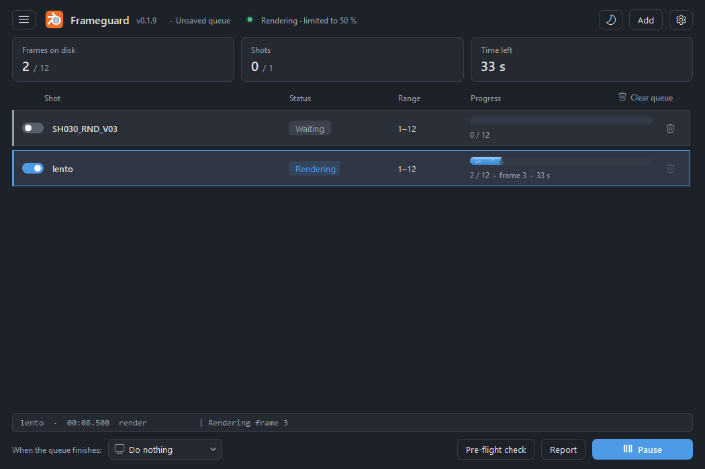

# Frameguard

**An overnight render queue for Blender that doesn't stop when something goes wrong.**

*[Leer en español](README.es.md)*

Rendering a batch of `.blend` files overnight usually means a `.bat` with one `blender -b file.blend -a` line per
shot, a spreadsheet to track what's done, and hoping nothing crashes. When Blender crashes at 3 a.m. (a GPU
driver reset, running out of memory, a frozen frame), the rest of the night is lost and you only find out in the
morning.

Frameguard replaces that with a visual queue that keeps watch while you sleep:

- **A queue instead of a .bat.** Drag in `.blend` files or whole folders; for each file it picks the highest
  version (`_V03` over `_V02`). Reorder shots, set frame ranges, and save the queue (`.fgq`) to reopen it whenever
  you need to re-render.
- **Real progress, counted on disk.** A shot is done when every frame exists on disk, freshly written and not
  empty. Frames are counted from the files your **File Output** nodes write, so it also works with
  *Save Output* turned off, including multi-scene compositor setups (render layers from several scenes, Cycles
  or EEVEE, into one multilayer EXR).
- **Automatic recovery.** If Blender crashes or freezes, Frameguard relaunches it and renders **only the missing
  frames**, then moves on to the next shot. Blender runs from a separate background engine, so closing the window
  doesn't stop anything, and after a restart the queue resumes from the last verified frame.
- **Before you go to bed:** a pre-flight check (missing textures or linked files, no camera, no outputs), a report
  when the queue finishes, notifications with sound, and shut down / sleep / restart when done (with a countdown
  to cancel).
- **Keep working while it renders:** an optional limit on how much of the CPU Blender may use, at low priority.

The interface is available in **English and Spanish** (it follows the Windows language).



## Download

Get the installer from the [Releases](../../releases) page and run it. It installs per user, without
administrator rights. Your queue, settings and logs are kept when updating.

- **Windows 10/11** only.
- **Blender:** developed and tested with Blender 5.2 (it uses the 5.x compositor API). It finds installations in
  `Program Files\Blender Foundation` automatically, or you can pick `blender.exe` in Settings.
- The installer is **not digitally signed** yet, so Windows SmartScreen may warn you the first time:
  click *More info → Run anyway*.

## Good to know

- Frameguard never saves your `.blend` files. *Save Output* is turned off only inside the render session.
- The CPU limit uses process affinity and priority. It **does not** limit the GPU (EEVEE, Cycles on GPU) or RAM:
  Windows offers no reliable way to throttle the GPU, and capping RAM would make Blender crash.
- It can't stop a GPU from overheating, but when a crash happens you no longer lose the night's render.

## How it was made

Frameguard was created by **Claude** ([Anthropic](https://www.anthropic.com)'s AI) in **Claude Code**, under the
direction of [@Poyframe](https://github.com/Poyframe), a lighting and rendering artist.

- **Direction (@Poyframe):** the problems from real production, the design decisions, and testing every version
  on real shots.
- **Development (Claude):** the code, the installer and the automated tests.

## Building from source

Requirements: Python 3.13, [Inno Setup 6](https://jrsoftware.org/isinfo.php) for the installer.

```bash
python -m venv .venv
.venv\Scripts\pip install -r requirements.txt
.venv\Scripts\python -m frameguard            # window (starts the engine if needed)
powershell -ExecutionPolicy Bypass -File build.ps1   # dist\installer\Frameguard-Setup-<version>.exe
```

`build.ps1` refuses to build if `tools/check_names.py` finds undefined names or `tools/check_i18n.py` finds texts
without an English translation. Tests live in `tools/pruebas/` (screenshots of every screen in both languages,
real drag and drop, notifications, CPU usage) and `tools/smoke_test.ps1`. They use their own data folder and
never touch your real queue or settings. Code comments are in Spanish.

## License

See [LICENSE](LICENSE). The installer bundles [Qt for Python (PySide6)](https://doc.qt.io/qtforpython/), used
under the LGPL-3.0.

Blender is a registered trademark of the Blender Foundation. Frameguard is an independent project and is not
affiliated with or endorsed by the Blender Foundation.
